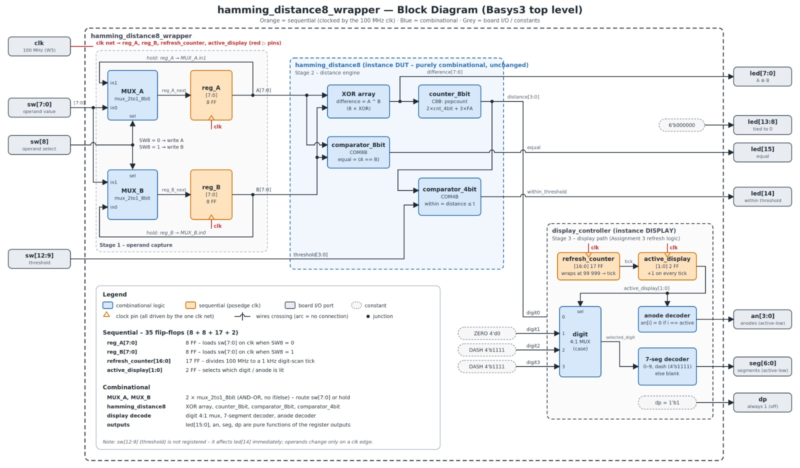
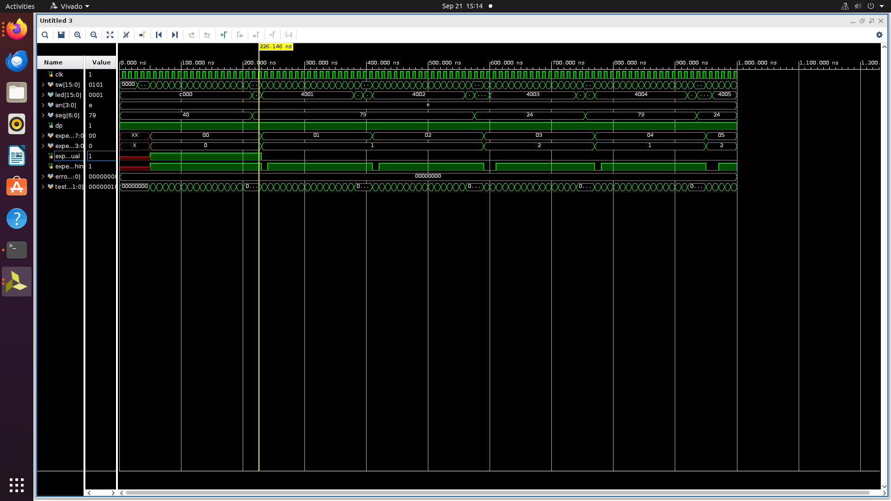
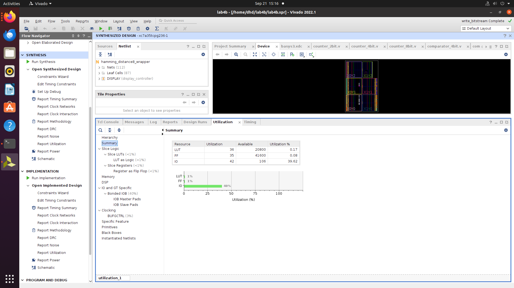
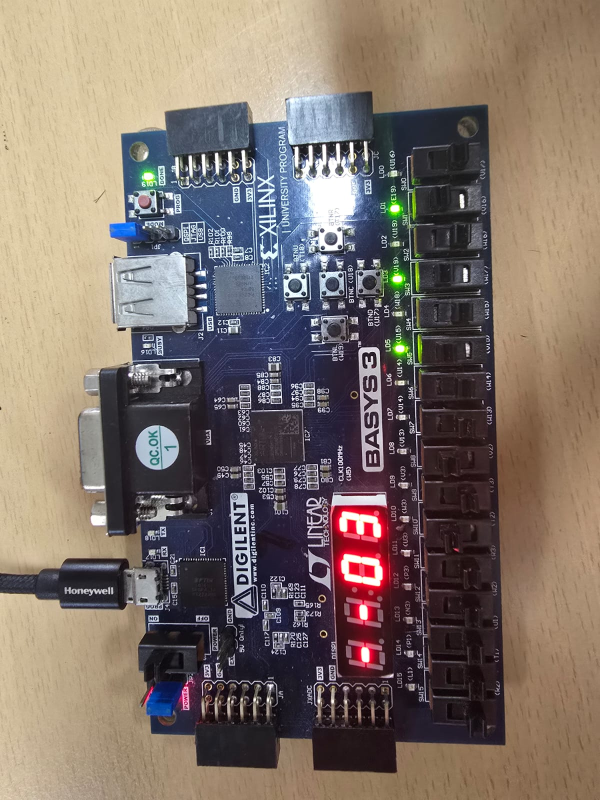

# FPGA Hardware Data Integrity & Bit-Error Detection Engine

A modular Verilog HDL implementation of an 8-bit Hamming-distance and threshold-comparison engine, synthesized and deployed on a Digilent Basys 3 FPGA.

The design measures bit-level deviation between a reference value and a received value, determines the Hamming distance between them, and checks whether the deviation remains within a programmable threshold.



## Overview

The core datapath computes:

The reference and received values are compared bit by bit. The differing bits form the error pattern, and the number of differing bits is reported as the error distance. The configured threshold is then used to determine the integrity status.

The system provides four primary outputs:

- **Error pattern** — bitwise XOR between the reference and received values
- **Error distance** — number of differing bits
- **Exact match** — indicates whether both values are identical
- **Integrity valid** — indicates whether the error distance is within the configured threshold

## Architecture

The RTL is organized hierarchically into reusable modules:

The design is divided into a top-level control module, a Hamming-distance core, and supporting datapath/display modules.

- `hardware_integrity_engine` captures the reference and received values, connects the processing modules, and drives the board outputs.
- `hamming_distance8` computes the XOR difference, Hamming distance, equality status, and threshold comparison.
- `counter_8bit` implements the population count hierarchically using two `counter_4bit` modules. These are built from `counter_2bit` modules and `full_adder` logic.
- `comparator_8bit` and `comparator_4bit` provide the comparison logic used by the Hamming-distance core.
- `mux_2to1_8bit` controls selection of the reference and received data during operation.
- `display_controller` drives the seven-segment display used to show the calculated error distance.

The population-count logic is implemented hierarchically rather than as a monolithic behavioral operation. The 8-bit counter is constructed from two 4-bit counters, which are themselves constructed from 2-bit counters and full adders.

## Hardware Interface

The design targets the **Digilent Basys 3** FPGA board.

| Interface | Function |
|---|---|
| `SW[7:0]` | 8-bit data input |
| `SW[8]` | Reference/received data select |
| `SW[12:9]` | 4-bit integrity threshold |
| `clk` | 100 MHz clock |
| `LED[7:0]` | Error pattern |
| `LED[14]` | Integrity-valid status |
| `LED[15]` | Exact-match status |
| 7-segment display | Error distance |

The complete Basys 3 pin mapping is provided in [`constraints/basys3.xdc`](constraints/basys3.xdc).

## Verification

The design includes an exhaustive behavioral testbench.

Every possible combination of:

- 256 reference values
- 256 received values
- 16 threshold values

is tested.

```text
256 × 256 × 16 = 1,048,576 test cases
```

The testbench contains an independent behavioral reference model that computes the expected error pattern, error distance, exact-match status, and threshold result and compares them against the hardware design.

The testbench is located at:

```text
simulation/testbench.v
```

A representative simulation waveform is available at:



## FPGA Implementation

The design was synthesized and implemented on a Digilent Basys 3 FPGA.

### Resource Utilization

| Resource | Usage |
|---|---:|
| LUTs | 36 |
| Flip-Flops | 35 |
| BRAM | 0 |
| DSP | 0 |
| I/O | 42 |
| LUT/FF utilization | < 1% |

The synthesized architecture and utilization results are included in [`results/`](results/).



A hardware demonstration was performed on the Basys 3 board:



## Hardware Security & Data-Integrity Relevance

The implemented circuit is a **Hamming-distance and threshold-comparison primitive**, rather than a complete cryptographic, authentication, or error-correcting-code system.

The underlying operation is relevant to systems that need to measure and bound bit-level deviations between binary values.

Potential application areas include:

- Bit-level data-integrity monitoring
- Corrupted-data or packet-deviation detection
- Threshold-based fault tolerance
- Hardware-response similarity checking
- PUF-oriented response comparison
- Hardware authentication pipelines

For example, in a PUF-oriented architecture, the Hamming-distance engine could serve as a hardware primitive for comparing a measured response against a reference response and determining whether the deviation falls within an acceptable threshold.

This project itself does **not** implement a PUF or an authentication protocol.

## Repository Structure

```text
hamming/
│
├── bitstream/
│   └── bitstream.bit
│
├── constraints/
│   └── basys3.xdc
│
├── results/
│   ├── basys3-demo.jpg
│   ├── block-diagram.png
│   ├── hamming_project_report.md
│   ├── rtl-schematic.png
│   └── synthesis-utilization.png
│
├── simulation/
│   ├── images/
│   │   └── waveform.png
│   └── testbench.v
│
├── src/
│   ├── comparator_4bit.v
│   ├── comparator_8bit.v
│   ├── counter_2bit.v
│   ├── counter_4bit.v
│   ├── counter_8bit.v
│   ├── display_controller.v
│   ├── full_adder.v
│   ├── hardware_integrity_engine.v
│   ├── hamming_distance8.v
│   └── mux_2to1_8bit.v
│
└── README.md
```

## Documentation

The detailed technical documentation is available in:

[`results/hamming_project_report.md`](results/hamming_project_report.md)

It contains the module-level architecture, datapath description, verification methodology, synthesis results, FPGA implementation details, and discussion of hardware security/data-integrity relevance.

## Project Status

The RTL design, exhaustive simulation, FPGA synthesis/implementation, and Basys 3 hardware demonstration are complete.
